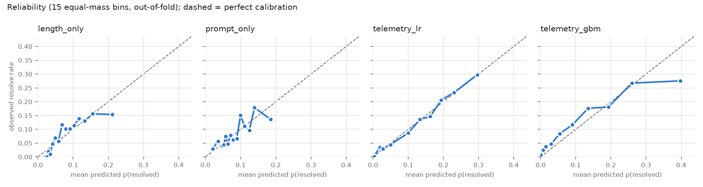

# TraceTrust-SE: Phase 1 baseline

AI4015 Agentic AI, project **G2-09** (*Observability and Trust in Agentic AI for Software Engineering*).
Muhammad Omer Khan (23I-0650). Base paper: SWE-Gym (Pan et al., ICML 2025).

Given the execution trace of an OpenHands software-engineering agent, predict whether the run
resolved its task (its final patch passes the hidden tests). The output is a calibrated
probability that can serve as a trust score, rank runs of the same task (best-of-n), or flag runs
for review.

This repository is the **Phase 1 technical foundation**: data pipeline, structured contracts, the
baselines from the proposal (§B.10), and the evaluation protocol with initial results. The design
is in [docs/architecture.md](docs/architecture.md).

## Quick start

Requires Python 3.11 and [uv](https://docs.astral.sh/uv/) (or plain `pip`). Windows paths are shown; on
Linux/macOS use `.venv/bin/python`.

```bash
uv venv --python 3.11
uv pip install --python .venv -r requirements.txt

.venv/Scripts/python -m src.run_baseline            # downloads ~300 MB on first run, then ~1 min
.venv/Scripts/python -m pytest -q                   # unit tests
```

`run_baseline` downloads the dataset from Hugging Face, parses every trace, builds features and
folds, runs the baselines with 5-fold cross-validation, and writes `results/`. Each stage caches
its output in `data/`; pass `--refresh` to rebuild.

### LLM-judge baseline (optional)

```bash
cp .env.example .env        # then pick a provider
.venv/Scripts/python -m src.run_baseline --with-llm
```

| `LLM_PROVIDER` | setup |
|---|---|
| `ollama` (default) | install [Ollama](https://ollama.com), then `ollama pull qwen2.5-coder:7b` (fits in 6 GB VRAM) |
| `gemini` | free key from Google AI Studio in `GEMINI_API_KEY` |
| `groq` / `openrouter` | free-tier key in `GROQ_API_KEY` / `OPENROUTER_API_KEY` |

The judge runs on a fixed 50-run sample and caches every reply in `data/llm_judge_cache.jsonl`.

## Data

[`SWE-Gym/OpenHands-Sampled-Trajectories`](https://huggingface.co/datasets/SWE-Gym/OpenHands-Sampled-Trajectories):
6,055 OpenHands runs (GPT-4o 5,826, Claude 3.5 Sonnet 229) on 2,438 SWE-Gym tasks from 11 Python
repositories, 1 to 10 runs per task.

| | |
|---|---|
| resolved rate | 8.1% |
| tasks with only failed runs / only resolved runs / both | 2,144 / 106 / 188 |
| runs in mixed tasks | 1,037 (1,394 same-task pass/fail pairs) |

**Leakage rule:** `test_result.report`, `test_output` and `apply_patch_output` are never read as
features, because they contain the label. Only the trajectory and the final git patch are used.

## Pipeline

```
HF Hub -> loader (light columns) -> parser (streams row groups -> Trace) -> features (RunFeatures, TaskFeatures)
       -> splits (GroupKFold by task + 50-run judge sample) -> baselines -> metrics -> results/
```

| module | role |
|---|---|
| [src/data/loader.py](src/data/loader.py) | download shards, light metadata table, dataset stats |
| [src/data/parser.py](src/data/parser.py) | OpenHands messages -> `Trace` of typed `Step`s (tool, command, path, exit code, error) |
| [src/schema.py](src/schema.py) | Pydantic contracts passed between every stage |
| [src/features.py](src/features.py) | telemetry features per run + pre-execution task features |
| [src/eval/splits.py](src/eval/splits.py) | 5-fold GroupKFold on `instance_id`, fixed judge sample |
| [src/eval/metrics.py](src/eval/metrics.py) | pooled AUROC, within-task AUROC, Brier, ECE |
| [src/baselines/tabular.py](src/baselines/tabular.py) | length-only, prompt-only, telemetry LogReg / GBM |
| [src/llm/provider.py](src/llm/provider.py) | `LLMProvider` interface: Ollama + OpenAI-compatible free tiers |
| [src/baselines/llm_judge.py](src/baselines/llm_judge.py) | zero-shot LLM judge with JSON-validated verdicts |
| [src/baselines/verifier_stub.py](src/baselines/verifier_stub.py) | `Verifier` interface for the SWE-Gym 32B verifier (Phase 2, Kaggle) |
| [src/run_baseline.py](src/run_baseline.py) | end-to-end runner |

## Evaluation protocol

- **Splits:** `GroupKFold(5)` on `instance_id`, so no task is in both train and test. All methods share the folds.
- **Pooled AUROC:** over all out-of-fold predictions.
- **Within-task AUROC:** over tasks with both resolved and unresolved runs, the share of same-task
  (pass, fail) pairs ranked correctly. It removes task difficulty and measures what best-of-n
  selection needs (proposal Gap 1).
- **Calibration:** Brier score, ECE over 15 equal-mass bins, reliability diagram.

## Initial results

Out-of-fold, all 6,055 runs (from [results/metrics.md](results/metrics.md)):

| method | pooled AUROC | within-task AUROC | Brier | ECE |
|---|---|---|---|---|
| length_only | 0.702 | 0.809 | 0.0724 | 0.0188 |
| prompt_only | 0.640 | 0.500 | 0.0734 | 0.0196 |
| telemetry_lr | **0.839** | **0.854** | **0.0654** | **0.0049** |
| telemetry_gbm | **0.839** | 0.844 | 0.0670 | 0.0202 |



Observations so far:

- Telemetry features beat both simple baselines on discrimination and calibration. The strongest
  signals ([results/metrics.json](results/metrics.json), `telemetry_lr_coefficients`) are an empty
  final patch (strongly negative), the number of distinct tools used, run length and patch size.
- `prompt_only` reaches 0.64 pooled AUROC from task difficulty alone, yet 0.5 within-task by
  construction. Pooled AUROC alone overstates what a predictor knows about an individual run.
- On this dataset within-task AUROC is not lower than pooled, unlike the gap the proposal
  hypothesises for SWE-bench (H1). Most tasks here have 1 to 3 runs and only 188 are mixed, so this
  needs re-testing on the k = 16 evaluation rollouts.
- On the label-balanced 50-run judge sample, every model's Brier and ECE degrade sharply (ECE about
  0.4) while its ranking holds. That is prior shift: models fit to an 8% base rate are miscalibrated
  on a 50% one, the same problem the proposal attributes to the 50/50-trained SWE-Gym verifier.

The LLM-judge row appears in `results/metrics.md` after a `--with-llm` run.

## Roadmap (Phase 2+)

SWE-Gym 32B verifier scores (Kaggle), prefix features at 25/50/75% for early warning, the full
20-feature schema, post-hoc and prior-shift calibration, cross-scaffold transfer (MoatlessTools,
SWE-agent), and the runtime governance monitor.
